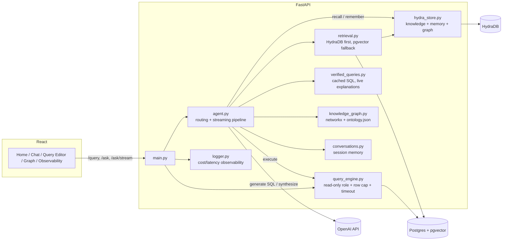

# Traceview

A GTM data assistant that answers plain-English questions with real SQL, retrieved account context, or both fused into one answer - not just a chatbot wrapper around a database. Read-only enforced at the database privilege level, evaluated by an independent LLM judge, built on GTM data for a fictional SaaS business.

**Status:** not deployed yet - this version runs locally (see [Running it locally](#running-it-locally)).


## What it does

Each question gets routed to one of four modes:

- **`sql`** - schema answers it directly (*"which accounts are at_risk?"*). Generates SQL, executes it, retries on error, streams a short explanation of the result.
- **`unstructured`** - only account notes or playbooks can answer it (*"how do I handle a pricing objection?"*). Retrieves the relevant chunks, synthesizes a cited reply.
- **`hybrid`** - needs a number *and* the story behind it (*"why is this account's consumption declining?"*). Runs the SQL, retrieves the notes, fuses them into one answer.
- **`chat`** - everything else, including an honest "I can't answer that" instead of a guessed number.

Every step is timed and shown in a reasoning trace under each answer. Home also surfaces a proactive panel on load - accounts trending under target before they're formally flagged at-risk - instead of waiting to be asked. There's also a raw SQL editor with the same safety guarantees, a knowledge graph viewer, and an observability dashboard with full cost/latency/trace detail per call.

## Company brain (HydraDB)

With a HydraDB key configured, HydraDB becomes the memory layer behind every answer - three things a vector index alone doesn't give you:

- **Shared knowledge** - every account note and playbook lives in one HydraDB collection. Each source carries a schema-declared `scope` (`global` or `account_<id>`), and every search filters on it server-side, so one account's notes never surface in another account's answer. pgvector stays wired in as the fallback: if a HydraDB call fails, the answer still arrives and the trace says which store answered.
- **Per-user memory** - say "keep answers to three bullets or fewer" once. The agent restates any durable fact a message reveals about the person asking, and that one sentence is stored in their own HydraDB collection and recalled in later conversations - so a preference stated on Monday still shapes Friday's answer, and one person's memories never surface for another. The Memory page shows everything remembered about you and lets you add to it or forget any of it. Who's asking is a name you set in the app, which is also what turns *"which of my accounts are at risk?"* into SQL filtered to that person's accounts; there's no login behind it, so it's identity for personalisation, not access control.
- **Context graph** - the structured facts Postgres already knows (which AE/SE/CSM is on an account, which workloads it's contracted on, each contract's status) are declared to HydraDB as a graph alongside the notes, on top of the graph HydraDB extracts from the text itself. Account questions are searched in HydraDB's "thinking" mode, which traverses that graph, and the answer shows the relationships it used (`bramwell capital partners --[HAS_CSM]--> owen martinez`).

A thumbs-up/down under each answer is sent back to HydraDB against the exact retrieval that produced it.

Without a key, none of this is required: retrieval runs on pgvector and there's no long-term memory.

## Agent capabilities

Behind every answer is a set of capabilities the agent draws on, not just one model call:

- **RAG (retrieval-augmented generation)** - before writing an `unstructured` or `hybrid` answer, the agent searches account notes and sales-enablement content via vector similarity search (pgvector) and grounds its reply in whatever it actually finds, instead of guessing from general knowledge. The same retrieval mechanism grounds SQL generation too, pulling the exact business-term definitions ("win rate," "active deal") relevant to a question so the model uses your definitions, not an inferred one.
- **SQL generation and execution** - writes a Postgres query for the question, runs it through a read-only database role with a row cap and timeout, and retries automatically (up to 3x) if the query errors, feeding the error back to the model to fix it.
- **Verified-query cache** - questions matching one already vetted by the eval suite skip generation entirely and run pre-approved SQL directly, at $0 cost and millisecond latency.
- **Knowledge graph lookup** - computes the real join path between tables from the schema's actual foreign keys before SQL gets written, so multi-table questions don't rely on the model guessing how tables connect.
- **Conversation memory** - follow-up questions ("now break that down by industry") resolve against the actual conversation history, not from scratch each time.

Every step above is timed and logged, and shown in the reasoning trace under each answer.

## Architecture



Pipeline per `/ask` call: verified-match check → retrieve business context (RAG) → graph lookup (join paths) → recall what's remembered about the asker (HydraDB) → generate SQL or a reply, streaming the writing step → execute, retrying on failure (up to 3x) → respond → remember the turn (HydraDB, in the background).

## Tech stack

| Layer | Choice | Why |
|---|---|---|
| Backend | FastAPI + Pydantic | Async, typed contracts, auto-generated docs |
| Data | Postgres + pgvector | Structured data and vector search under one privilege model |
| Migrations | Alembic | Schema changes are incremental and versioned, not a drop-and-recreate on every reseed |
| Company brain | HydraDB | Shared knowledge, per-user memory and a context graph behind one query API; optional, with pgvector as the fallback |
| Vector search | pgvector + `all-MiniLM-L6-v2` | Local embeddings, no API cost; cosine search is a normal SQL `ORDER BY` |
| Knowledge graph | networkx | In-memory, derived from real foreign keys |
| LLM | OpenAI (`gpt-4o` generation, `gpt-4o-mini` judge) | Cheaper model for a narrower verification task |
| Streaming | Server-Sent Events | Only the free-text writing step streams - structured routing output can't stream meaningfully |
| Frontend | React + Vite + CodeMirror | Real SQL syntax highlighting, fast dev loop |
| Tests | pytest (59 tests) | The actual security and isolation boundaries, not incidental coverage |
| CI | GitHub Actions | pytest + frontend build on every push; eval suite on manual trigger |

## Running it locally

**Backend:**
```bash
cd backend
python3 -m venv venv && source venv/bin/activate
pip install -r requirements.txt
cp .env.example .env   # add your OPENAI_API_KEY and DATABASE_URL
alembic upgrade head   # creates the schema (safe to re-run any time)
python -m scripts.seed_db
python -m scripts.seed_unstructured
python -m scripts.embed_content
python -m scripts.seed_glossary
python -m scripts.seed_verified_queries
uvicorn app.main:app --reload
```

Needs Python 3.10+ (the HydraDB SDK's minimum). To turn on the company-brain layer, add `HYDRA_DB_API_KEY` to `backend/.env` (get one at [app.hydradb.com](https://app.hydradb.com)) and load the knowledge once:

```bash
python -m scripts.seed_hydra           # creates the database, ingests notes + playbooks + the account graph
python -m scripts.seed_hydra --prune   # later: removes HydraDB sources whose Postgres row is gone
```

The test suite never calls HydraDB, key or no key - `tests/conftest.py` forces the pgvector path, and the HydraDB tests run against a fake client.

If something else on your machine already owns `localhost:5432` (a Homebrew Postgres will silently shadow the container), put `DB_PORT=5433` in a `.env` next to `docker-compose.yml` and use that port in `backend/.env`.

**Frontend:**
```bash
cd frontend
npm install
npm run dev
```

**Tests:**
```bash
cd backend
pip install -r requirements-dev.txt
pytest -v
```

**Eval suite** (costs a small amount of real OpenAI API usage):
```bash
cd backend
python -m scripts.run_eval
```

**Docker:**
```bash
docker compose up --build
```

## Project history

Built incrementally with Claude Code as a pairing partner.
